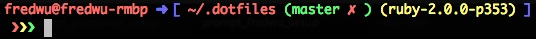

# Fred Wu's dotfiles



An opinionated, idempotent development environment for macOS and Linux. The
installer configures Zsh and Prezto, Neovim with LazyVim, command-line tools,
and the dotfile links in this repository.

## Supported systems

- macOS with Apple Command Line Tools installed
- Debian or Ubuntu (`apt`)
- Fedora (`dnf`)
- Arch Linux (`pacman`)

Both x86-64 and ARM64 Linux are supported. Other Linux distributions can still
use the repository, but the installer stops with a clear error when it cannot
find a supported package manager.

## Installation

```sh
git clone https://github.com/fredwu/dotfiles.git ~/.dotfiles
cd ~/.dotfiles
./install.sh
```

Run the installer as your regular user, not with `sudo`; it requests elevated
permissions only for system package and login-shell changes.

It is safe to run `./install.sh` again. Existing files at managed paths are
moved to a timestamped directory under `~/.dotfiles-backups` before links are
created. Correct links, existing package installations, fonts, and Git
checkouts are left alone.

Claude Code, Codex, and Grok keep real configuration directories at
`~/.claude`, `~/.codex`, and `~/.grok`. Their instruction files link to
`ai/shared`. [Skillshare](https://skillshare.runkids.cc/) 0.26.4 or newer manages
shared resources from `ai/skillshare`. Linux installs pin 0.26.4; Homebrew may
provide a newer compatible release. Bootstrap provisions a locked, private YAML
parser under `.local/skillshare-node` with `npm ci --ignore-scripts`.
Install the MCP launchers selected in intent too: currently `npx`, `uvx`, and
the Docker CLI. Preparation checks required launchers before configuration
writes; it does not install container engines or vendor applications.

`ai/skillshare/intent.json` declares the owned configuration fields and selected
destinations. Preparation updates those fields in the local Skillshare YAML,
preserves unrelated settings and native metadata, and detects local edits to
owned fields. Change owned settings here, then run:

```sh
./scripts/skillshare-sync --dry-run
./scripts/skillshare-sync
```

Run `./install.sh` for initial setup. Its Skillshare step uses
`./scripts/skillshare-sync --bootstrap` to adopt the existing configuration and
migrate the old directory links. Bootstrap keeps verified backups before it
moves vendor files or replaces generated agents. The managed command requires
the parser installed by bootstrap.
Existing configurations require `--bootstrap` for their first adoption.
Bootstrap stops before replacing a different external MCP source; migrate that
source deliberately first so its unrelated servers stay managed. The declared
`sources.mcp` must match the generated MCP file.
An interrupted migration that already recorded its owned settings can resume
through the normal command. If a native MCP conflict blocks legacy migration,
its staged source and ownership records are restored while skills and agents
continue.

Skills live in `ai/skillshare/skills`. Runtime skill directories are real
folders; merge mode creates a link for each maintained skill. Source edits are
therefore visible through existing links, and sync reconciles additions and
removals. Vendor-local skills stay in their owning runtime. Codex and Grok read
the shared universal directory (`~/.agents/skills`); their own skill directories
remain available for vendor content without duplicate shared delivery. Primary
Claude, Claude Gamma (`~/.claude-gamma`), and Mimo have separate merge targets.
Gamma has its own skills and agents folders; account-local files do not leak
through a shared whole-directory link. Catalog changes may require a new session.
Merge mode cannot prevent writes through links: edit shared skills here and
keep vendor installs in real local folders.

Shared agents use neutral templates in `ai/skillshare/agents` and native
conversion extensions in `ai/skillshare/extensions`. Provider models and effort
values are defined only in `ai/skillshare/agent-models.json`. Managed sync
validates and renders them before native publication, verifies the output, and
restores backed-up agents if publication fails. Primary Claude, Gamma, and
Codex receive converted files. Edit the templates or model map; direct edits
to generated files are backed up and replaced. Native status and dry-run do
not execute converters, so status alone cannot detect a model-map change.

`ai/skillshare/mcp.json` holds portable shared MCP definitions. The command
resolves executable bindings into one real local
`~/.config/skillshare/mcp.generated.yaml`; machine paths and application build
snapshots stay outside Git. Shared MCP destinations are primary Claude, Codex,
OpenCode, Grok, and Claude Desktop on supported platforms. Linux omits
Desktop. URL servers and environment references omit Desktop because its native
adapter cannot render them. Sync reports these omissions. Gamma is deliberately excluded. Add a
supported destination to `mcp.targets` in intent to receive the inherited
shared set, including Godot AI.

Ownership has three cases:

- Repository-owned resources change here and publish through Skillshare.
- Externally maintained shared resources declare one named local input in
  `intent.json`. Godot AI uses the primary Claude MCP entry. Managed sync reads
  that entry through Skillshare, captures accepted portable changes into Git,
  then publishes them. A declared local skill can use the same refresh flow
  through native installation and its audit gate.
- Vendor-local resources stay vendor-owned: Codex `node_repl`, bundled or
  curated plugins, Codex `.system`, account `synced` buckets, and plugin hooks.
  The `cua-driver` updater owns its skill; bootstrap creates an ignored local
  source link to `~/.cua-driver/skills/cua-driver` when it is installed.

A local last-applied record distinguishes a vendor update from a Git update.
If only the vendor input changes, the portable source updates. If another
computer has newer tracked MCP content, the older computer holds that resource
at its last local baseline until its vendor is updated. If both sides differ,
MCP publication stops for a source choice; skills and agents still sync, and
the command reports blocked MCP names with a failing exit status. Resolve the
choice by making the selected portable definition and vendor input agree.
Missing external entries on fresh setups remain pending while other servers
publish. If a previously managed entry disappears, the native MCP plan is held
to avoid recreating it and mistaking it for a vendor update. Skills and agents
still sync. No version comparison,
watcher, automatic upstream update, or automatic commit is involved.

MCP previews must match the selected destinations and their native file paths,
including OpenCode's existing `opencode.jsonc`. For another native adapter,
declare its expected path in `intent.json` under `mcpPaths` when it is not one
of the built-in checked paths. Named account targets use their declared
provider and configuration directory. Managed subprocesses clear inherited
client-directory overrides and use the declared account paths. The caller's
environment stays unchanged. A stopped process's lock is recovered;
an active sync keeps its lock.

The Skillshare dashboard and raw CLI do not run external refresh or the agent
recovery checks. Use the managed command after vendor updates and when onboarding
a destination. Native `install`, `update`, and `uninstall` remain the explicit
workflow for ordinary upstream skills. Review and commit tracked changes.
The upstream Godot `first-index` diagnostic can misread a hardened uv resolver
option as a package; keep the existing resolver controls.

Migration backups live under `~/.local/state/dotfiles` (including configuration
backups and `skillshare-runtime-backups/*/manifest.json`). Runtime restoration
is available through `restoreBackup` in `install/lib/skillshare-runtime.js`;
preview restoration with `dryRun: true` before applying it. Native MCP operations
also retain their own backups. Quarantined source trash remains in the verified
runtime backup, outside active discovery. Preserve these backups until the
migrated setup is confirmed on your machine. Existing shared instruction links
remain separate from Skillshare ownership. The current herdr/native-plugin
hooks remain vendor-owned; Grok has no Skillshare hook adapter.

`ai/skillshare/plugins.json` records seven portable user-plugin recipes with
exact installed commits. Bootstrap adopts matching installations with native
import, or rebuilds missing selections with pinned native add. It preserves
native enablement and does not upgrade an existing installation. Disabled
plugins, automatic dependencies, Expo's external source, and Codex plugins
without an exact installed commit remain explicitly local. Bundled and curated
OpenAI plugins stay outside shared management. Normal managed sync reports
plugin holds or missing selections; use `--bootstrap` for adoption/rebuild.

The installer changes the account's login shell to Zsh when necessary. Open a
new terminal after it completes.

### Migrating the legacy Vim setup

Run this once on a machine previously configured by the old installer:

```sh
./install.sh --cleanup
```

Cleanup recognises the old spf13-vim checkout, its Vundle plugin tree, known
Vim symlinks, the obsolete Droid Nerd Font, and `use-agent` in the GnuPG
configuration. The Vundle tree, old font, and other ambiguous or modified data
are always archived for manual review; verified generated data is removed.
Historical `*.backup.*` files and `~/.viminfo` are always preserved. Cleanup is
repeatable and then performs the normal install.

## What is installed

- [Prezto](https://github.com/sorin-ionescu/prezto) with prezto-contrib
- [Neovim](https://neovim.io/) and [LazyVim](https://www.lazyvim.org/)
- Hack Nerd Font
- Git, GnuPG, direnv, fzf, zoxide, ripgrep, fd, Node.js, mise, and related build tools
- Grok, Codex, and Claude Code CLI casks on macOS
- Skillshare, with shared skills and agents stored in this repository
- Shared instructions for Claude Code, Codex, and Grok

On Linux, official pinned Neovim, mise, Skillshare, and Tree-sitter builds are
installed under `~/.local/opt` as needed. The pinned Neovim is used when the
distribution package is older than the version required by the locked LazyVim
configuration.

## Custom configuration

- Put personal shell values in `~/.zsh_custom`; the installer creates it once
  from `zsh/custom.example` and never overwrites it.
- Use `sr` to reload `.zshrc`.
- Add LazyVim options, keymaps, autocommands, and plugin specifications under
  `config/nvim/lua`.

## Installer development

The entry point is intentionally small; implementation modules live in
`install/lib`. Run the isolated test suite with:

```sh
/bin/bash install/tests/run.sh
```

The tests use temporary homes and require Skillshare 0.26.4 or newer, Node,
npm, and the standard shell tools. Parser bootstrap may fetch its pinned npm
dependency; package-manager and system-install tests use doubles. They do not
need root privileges or start MCP servers.
